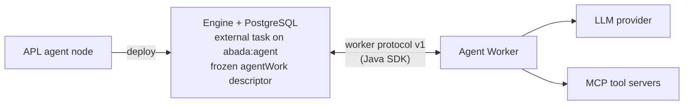

import { Aside } from '@astrojs/starlight/components';

An APL `agent` node never calls a model itself. It becomes a **durable external
task** that a separate worker takes, works on outside every database
transaction, and hands back through an engine command that the engine
validates.



The engine never connects to a model or a tool server. The worker never
advances a process. Three layers share the work.

## Layer 1 — the SDK: a protocol client

`io.abada:abada-worker-client` (Apache 2.0, under `sdk/java/`) is a thin HTTP
client for external-worker protocol v1. It has no agent logic; any worker can
use it.

| SDK method | Endpoint | Purpose |
| --- | --- | --- |
| `registerCapabilities` | `PUT /v1/workers/me` | declare the topics (and models) this worker serves |
| `fetchAndLock` | `POST /v1/external-tasks/fetch-and-lock` | claim up to N tasks with a lease |
| `extendLock` / `heartbeat` | `POST …/{id}/extend-lock` | keep the lease alive |
| `complete` | `POST …/{id}/complete` | hand back the result and attempt metadata |
| `fail` | `POST …/{id}/failure` | technical failure, retry or deferral |
| `failWithCode` | `POST …/{id}/failure` | final, routable failure |
| `bpmnError` | `POST …/{id}/bpmn-error` | business error routed by `on_error` |
| `recordStep` | `POST …/{id}/steps` | the agent step journal |
| `toolCredential` | `GET …/{id}/tool-credentials/{server}` | a tool server's secret, for the lease holder only |
| `aiCredentials` | `GET /v1/workers/me/ai-credentials` | the provider keys configured in Studio |

The records carry the contract: `LockedExternalTask` (the task, plus
`agentWork`, the journaled `steps` of the current attempt and `priorWrites`),
`AgentWorkDescriptor`, `ToolBinding` (server, tool, policy, idempotency,
approvers, URL and the credential's **name**, never its value), `AgentStep` and
`AgentAttemptMetadata`. Every mutation can carry an `Idempotency-Key` and W3C
trace context through `RequestOptions`.

## Layer 2 — the Agent Worker: the loop

The first-party worker (`agent-worker/`) is built on the SDK.

1. **Start-up.** It authenticates (OIDC client credentials), registers the
   global `abada:agent` capability — retrying while the identity provider or
   engine starts — and loads provider keys from the engine, cached and
   refetched on a 401/403 so a rotated key applies without a restart.
2. **Runner.** A semaphore bounds the work to `ABADA_AGENT_MAX_TASKS`; the
   worker fetches only as many tasks as it has free slots, runs each on a
   virtual thread and extends each lease every third of its duration (see
   [Many instances at once](/walkthroughs/concurrency/)).
3. **One task.** It checks the `abada.agent/v1` profile and its own tool
   allow-list, builds the model chain (declared model, then `fallback_models`,
   used only while a model is *unavailable*), opens tool sessions on demand
   and runs the agent loop.
4. **Outcome.** A result → `complete`; a limit or contract mismatch →
   `failWithCode`; every model unavailable → a deferral that keeps the attempt
   budget; a proposed approval or a delegation → **nothing is reported**,
   because the engine has already parked the work.

### The agent loop

Without tools, the loop is a single journaled model call. With tools:

1. **Offer only bound tools.** For each binding the worker lists the server's
   tools over MCP (`tools/list`). A missing tool, or an input schema that no
   longer matches the pinned `input_schema_sha256`, ends the attempt with
   `TOOL_CONTRACT_MISMATCH`. Bound tools are offered to the model as functions
   `<server>__<tool>`; delegates as `delegate__<process>`.
2. **Separate instructions from data.** The system message is a fixed guard
   plus the author's prompt, with each `${path}` replaced by an `<input>`
   reference; the declared input values travel in the user message.
3. **Resume from the journal.** Finished model turns and tool calls are
   replayed from the engine's journal, never paid for twice.
4. **Loop.** Model turn → tool calls in order → model turn, until the model
   answers without a tool call. Tool results are tool messages only, capped at
   `ABADA_AGENT_MAX_TOOL_RESULT_BYTES`; they cannot change the tools, the
   limits or the result variable.

| Tool policy | What the worker does |
| --- | --- |
| `read` | calls the tool, then journals the result |
| `write` | journals `STARTED` **first**, receives the engine's idempotency key, calls the tool with it, then journals the result |
| `approval_required` | journals `PROPOSED`; the engine parks the work until a person decides ([walkthrough](/walkthroughs/approval-refund/)) |
| not bound | answers the model with an error; nothing runs |

## Where MCP fits

- The worker uses the official MCP Java SDK over **streamable HTTP** only;
  `stdio` is not supported.
- The bearer token is the project's tool credential, issued by the engine only
  to the worker holding a live lease on a task bound to that server, with
  `Cache-Control: no-store`. It is encrypted at rest with
  `ABADA_ENCRYPTION_KEY`.
- A write's idempotency key travels as the `Idempotency-Key` HTTP header and
  as `_meta.idempotencyKey` in the call.
- Text content is passed to the model; other content types are replaced by a
  marker.

Tool servers are project resources of kind `TOOL_SERVER`:

```yaml
name: crm
transport: streamable-http
url: https://crm-mcp.acme.internal/mcp
credential: crm-token            # the credential's name, never the secret
tools:
  get_customer:  { policy: read }
  create_ticket: { policy: write, idempotency: key }
  refund:        { policy: approval_required, idempotency: key, approvers: [finance] }
```

At deployment the engine resolves each `tools:` reference of an agent node
against these documents and **freezes** the bindings with the definition
version. Editing the tool server later never changes running instances.

<Aside type="tip" title="Three allow-lists">
  The tool server document lists the tools that exist; an agent node may only
  tighten a policy (`write` → `approval_required`), never loosen it; and the
  worker's operator limits the servers it may reach with
  `ABADA_AGENT_ALLOWED_TOOLS`. A deployment cannot widen any of them.
</Aside>

## Layer 3 — the engine: the guard

The journal is not a log the worker writes for itself; the engine decides
whether each step may happen. Recording a step locks only the external-task
row, never the instance, and refuses:

- a lease that expired or belongs to another worker, or a stale attempt;
- a skipped sequence, or a new step while the previous one is still open;
- a tool that is not bound to the node (`TOOL_NOT_BOUND`);
- a write not journaled `STARTED` first (`WRITE_AHEAD_REQUIRED`), or an
  approval-required call not proposed (`APPROVAL_REQUIRED`);
- a model call beyond `max_turns`, `max_tokens_total` or `budget_usd`.

It also derives each write's idempotency key from task, attempt and sequence,
answers a write that an earlier attempt already completed from the journal
(`reused`), and never re-sends a write without a key after a crash — that
becomes a `TOOL_OUTCOME_UNKNOWN` incident for a person.

When the result arrives, the engine enforces the **output contract** in the
completion transaction: only `result_variable` is written, it must match
`output_schema`, and `_confidence` must reach `confidence_threshold`;
otherwise `on_invalid_output` or `on_low_confidence` is taken.

## Recovery at a glance

| Interruption | What happens |
| --- | --- |
| Crash or lost lease during a model call | the next lease re-runs the open call; completed turns are reused |
| Crash during a keyed write | re-sent with the **same** key; the server deduplicates |
| Crash during a write without a key | never re-sent; a person confirms the outcome |
| Every model rate-limited | deferral after `Retry-After`, attempt budget kept |
| Delegation to a child | work parked without a lease; the child's outputs become the tool result |

External side effects remain **at-least-once**; they take effect once only
when the tool server honours the idempotency key.

## Evidence and reference

- Worker: `AgentLoopTest`, `AgentToolLoopEndToEndTest` (stub model and stub MCP
  server).
- Engine: `PostgresAgentStepJournalTest`, `PostgresAgentLimitsTest`,
  `FirstPartyWorkerCapabilityTest`.
- Contracts: [agent worker reference](https://github.com/bashizip/abada-platform/blob/dev/docs/reference/agent-worker.md),
  [external-worker protocol v1](https://github.com/bashizip/abada-platform/blob/dev/docs/reference/external-worker-protocol-v1.md),
  [APL tools and tool servers](https://github.com/bashizip/abada-platform/blob/dev/docs/reference/apl-specification.md).

Next: [a CRM call and back to the engine](/walkthroughs/tool-call-round-trip/).
