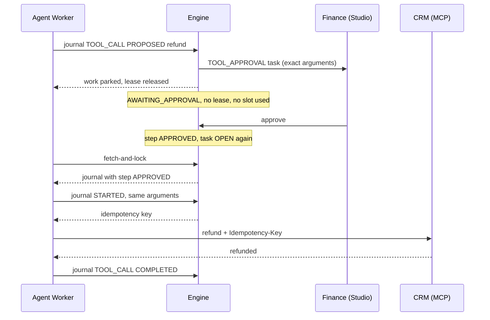
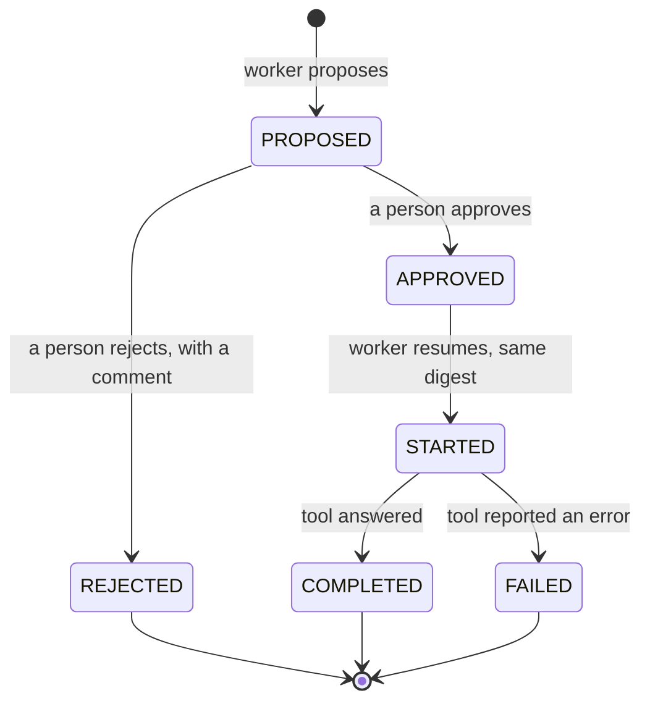

import { Aside } from '@astrojs/starlight/components';

Alice's parcel is lost and the agent decides to refund her €89. With
`approval_required`, the agent may **propose** the refund; only a person in
finance may **authorise** it.

## The setup

```yaml
# Tool server "crm"
tools:
  get_customer:  { policy: read }
  create_ticket: { policy: write, idempotency: key }
  refund:
    policy: approval_required
    idempotency: key              # the CRM accepts a deduplication key
    approvers: [finance]          # who may decide
    approval_sla_hours: 4         # an approval waiting longer is marked escalated
```

```yaml
# Agent node
- id: triage
  type: agent
  tools:
    - crm/get_customer
    - crm/create_ticket
    - { ref: crm/refund, approvers: [finance-leads] }   # this node narrows the approvers
```

A node may **tighten** a policy (`write` → `approval_required`) or name its own
approvers; it can never loosen a policy. An `approval_required` tool with no
approvers on either side is refused at deployment (`ABADA-APL-TOOL-003`).

## The sequence



## Step by step

### 1. The agent proposes

The model has read Alice's record and asks for
`crm__refund({"orderId":"5531","amount":89,"currency":"EUR"})`. The worker does
**not** call the CRM. It journals a proposal:

```json
POST /v1/external-tasks/task-7f3/steps
{
  "workerId": "agent-worker-1", "attempt": 1, "sequence": 5,
  "kind": "TOOL_CALL", "state": "PROPOSED", "toolRef": "crm/refund",
  "request": { "callId": "call_9", "arguments": { "orderId": "5531", "amount": 89, "currency": "EUR" } }
}
```

In the **same transaction** the engine stores the digest of the exact request,
moves the task to `AWAITING_APPROVAL`, takes the lease back, and opens a
`TOOL_APPROVAL` human task for `finance-leads`. A worker that tried to journal
`STARTED` directly would be refused with `APPROVAL_REQUIRED`: it cannot forget
to ask.

The worker frees its slot. It keeps nothing in memory; the whole conversation
is in the journal.

### 2. The wait

No worker can take the task: acquisition only selects `OPEN` tasks or expired
leases. The wait can last minutes or days at no cost, and survives a full
platform restart because it lives in PostgreSQL.

The approver sees the tool (`crm` / `refund`), the agent node, the model, the
attempt and step, and the exact arguments as the project's evidence policy
keeps them — then **approve** or **reject**.

### 3. The decision

| Finance… | The engine |
| --- | --- |
| approves | moves step 5 to `APPROVED` and the task back to `OPEN` |
| rejects (a comment is required) | moves step 5 to `REJECTED` with the comment and the task back to `OPEN` |

- A **worker credential can never decide**, whatever else it holds.
- The decision **does not move the token**; it only lets the agent continue.
- History records who decided, when, and on which argument digest.

### 4. The resumption

A worker — not necessarily the same one — takes the task, receives the journal
and rebuilds the conversation without calling the model again for finished
steps.

**Approved.** The worker journals step 5 `STARTED` with **exactly the same
request**. The engine compares the digest: any change — 890 instead of 89 — is
refused with `DIVERGENT_STEP`, because the person approved *this* call. When the
digest matches, the engine returns the idempotency key, the worker calls the
CRM with it, journals `COMPLETED`, and the model carries on.

**Rejected.** The CRM is never called. The model reads, as the tool's answer:

```text
Rejected: a person did not approve this call. Reason: Already refunded with a gift card on 12 October.
```

It continues with that fact — for example by answering without a refund.

## The life of the step



## Edge cases

| Situation | Behaviour |
| --- | --- |
| The worker crashes after sending `PROPOSED`, before the answer | it re-sends the same proposal; the engine recognises it and opens no second approval |
| No decision within `approval_sla_hours` | the approval is marked escalated (`TASK_SLA_BREACHED`); its candidates do not change |
| The process is cancelled while waiting | a late decision is refused (`WORK_RETIRED`); the call never runs |
| The worker crashes during the approved call | the next lease re-sends it with the **same** key |
| `idempotency: none` instead of `key` | an interrupted call is never re-sent: a `TOOL_OUTCOME_UNKNOWN` incident asks a person |
| A later attempt reproduces exactly the same refund | the engine answers it from the journal (`reused`) — no second approval, no second call |

<Aside type="tip" title="See it in Studio">
  [Tutorial: an agent that acts](/user/tutorial-agent-that-acts/) runs this
  scenario with a stub payments server, including the approval screen and a
  crash in the middle of the refund.
</Aside>

Evidence: `PostgresToolApprovalTest`, `ToolApprovalApiTest`,
`PostgresAgentStepJournalTest`.

Next: [delegating to a sub-process](/walkthroughs/delegation/).
