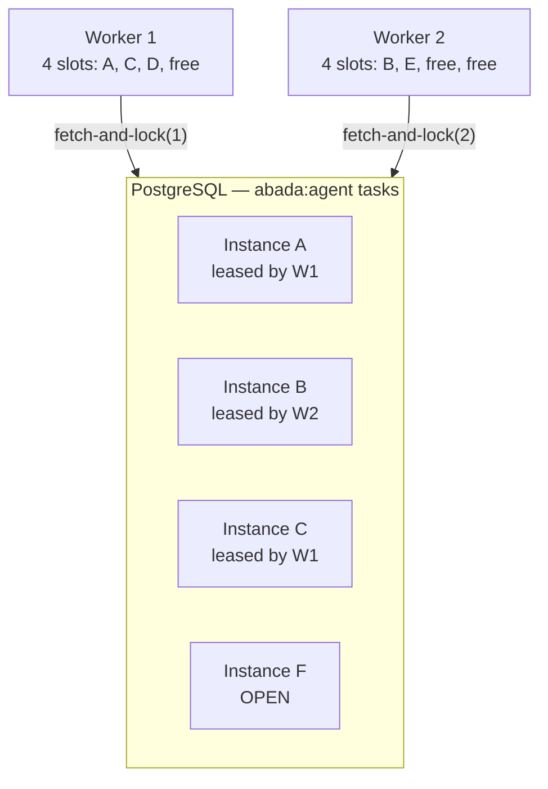

import { Aside } from '@astrojs/starlight/components';

Every process instance that reaches an `agent` node creates **one row** in
`external_tasks`. Twenty customers writing at once means twenty independent
tasks on the `abada:agent` topic. Concurrency is handled at three levels.



## Level 1 — inside one worker: slots

A worker has a fixed number of slots, `ABADA_AGENT_MAX_TASKS` (default 4,
at most 50), implemented as a semaphore in the worker's runner.

1. Count the free slots; with none free, ask for nothing.
2. Ask the engine for **exactly that many** tasks. A worker never holds work it
   cannot start, so no task waits inside a busy worker while another is idle.
3. Run each task on its own **virtual thread**. An agent spends most of its
   time waiting for the model or a tool, which virtual threads make cheap.
4. When a task ends, its slot is released and the next poll fills it.
5. With nothing to do, wait `ABADA_AGENT_POLL_INTERVAL_MS` (default 1 s).

| Private to each task | Shared, thread-safe |
| --- | --- |
| the conversation with the model | the HTTP client to the engine |
| the MCP sessions (one pool per task, closed at its end) | the cached provider keys |
| the tool server secret, requested per task | the worker's OIDC token |
| the journal, turn counter and token usage | one heartbeat thread for every lease |

Two tasks running side by side never see each other's messages, tool results
or budget.

**Heartbeats.** A single scheduled thread extends each running task's lease
every third of `ABADA_AGENT_LOCK_DURATION_MS` (every 40 s for the default
120 s), so a slow model call never lets a lease expire. If an extension is
refused, the worker marks the lease lost and **reports nothing** for that task:
another worker already owns it.

## Level 2 — between workers: PostgreSQL arbitrates

Any number of worker replicas may poll. When two ask for the same open task at
the same moment, the engine's acquisition query decides:

```sql
select * from external_tasks
where topic_name = 'abada:agent'
  and (status = 'OPEN' or (status = 'LOCKED' and lock_expiration_time <= :now))
order by id limit 1
for update skip locked
```

`FOR UPDATE SKIP LOCKED` locks the row being claimed and makes a concurrent
claimer skip it rather than wait. Exactly one worker gets the task; the other
moves on or receives nothing. The `lock_expiration_time <= :now` clause lets a
task whose worker died be re-acquired once its lease expires.

### When two workers still meet on one task

Worker 1 freezes for three minutes (a long pause, a network split); its lease
expires and Worker 2 takes the task. When Worker 1 wakes up:

| Worker 1 tries to… | The engine answers |
| --- | --- |
| extend the lease | refused — Worker 1 abandons the task silently |
| journal a step | `WORKER_LOCK_NOT_OWNED`, `WORKER_LOCK_EXPIRED` or `STALE_ATTEMPT` |
| fetch the tool credential | refused — issued to the lease holder only |
| complete or fail | refused — the lease is not its own |

Worker 2 resumes **from the journal**: finished steps are not redone and a
started keyed write is re-sent with its original key. The worst case is a
model call paid twice, never a write performed twice by a server that honours
the key.

## Level 3 — several agents in one instance

Two `agent` nodes after a parallel split are **two tasks**, and may run on two
slots or two workers.

- Journaling a step locks only that task's row, never the instance, so the two
  agents do not block each other while they work.
- Completion is an ordinary engine command that advances the instance in one
  transaction. If the task changed between the engine's access check and the
  command (`409`), the worker retries once with the same idempotency key, so a
  paid-for result is not thrown away.

## A worked load example

Twenty tasks arrive at once, with two workers of four slots each:

```text
t=0s   20 tasks OPEN
t=0s   W1 claims 4, W2 claims 4        -> 8 running, 12 waiting
t=6s   one W1 task completes           -> W1 has 1 free slot and claims 1 task
...    every completion frees a slot that the next poll fills
```

## Limits to keep in mind

- Within one task, tool calls run **one after another**, so the journal keeps a
  strict order.
- The provider is often the real bottleneck. On a rate limit the worker tries
  `fallback_models`; when every model is unavailable it **defers** the attempt
  without consuming it.
- To scale, raise `ABADA_AGENT_MAX_TASKS` or add worker replicas; both are safe
  because of level 2. See [Scaling](/user/scaling/).
- A tool server sees as many concurrent MCP sessions as there are running tasks
  bound to it; size it accordingly.

<Aside type="note" title="Evidence">
  Concurrent acquisition, lease recovery and duplicate-request behaviour are
  covered by the PostgreSQL cluster tests described in
  [Cluster execution](/architecture/cluster/); worker-side slots, heartbeats and lock
  loss by `AgentWorkerRunnerTest`.
</Aside>

Next: [a refund that needs approval](/walkthroughs/approval-refund/).
