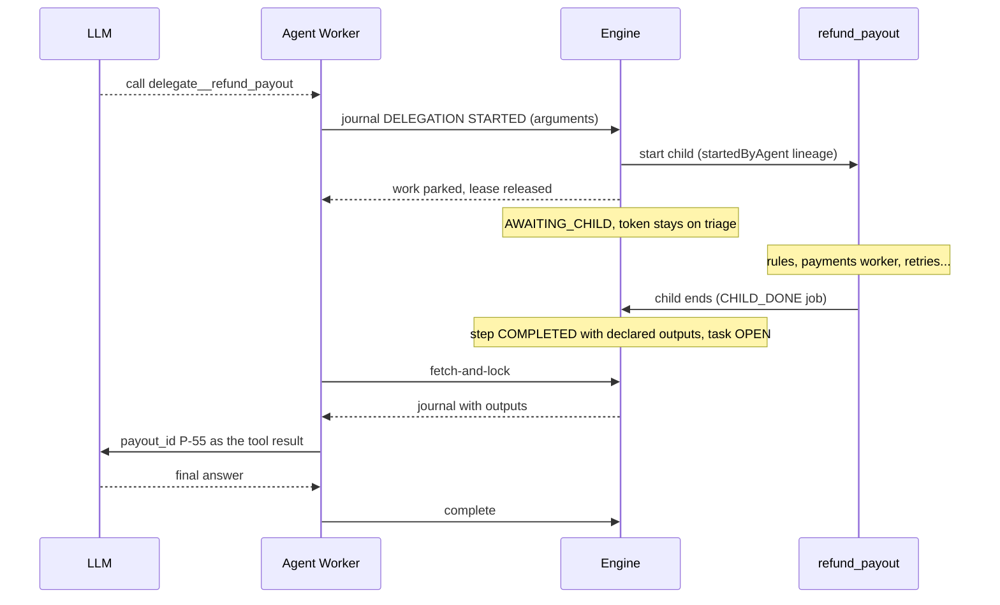

import { Aside } from '@astrojs/starlight/components';

Instead of calling a tool, an agent can hand part of the work to **another
complete process**. Here Alice's refund goes through `refund_payout`, a process
with its own rules, its own payments worker and its own audit trail.

## The setup

The child process, deployed in the same project:

```yaml
metadata:
  variables:                       # the child's inputs — the schema the model sees
    orderId:  { type: string }
    amount:   { type: number }
    currency: { type: string }
flow:
  nodes:
    - id: check_policy             # deterministic rule, no AI
      type: decision
      # ...
    - id: pay                      # third-party payments worker, writes payout_id
      type: engine-task
      service: payments.payout
    - id: done
      type: end
```

The agent node that may delegate:

```yaml
- id: triage
  type: agent
  model: gemini-3.6-flash
  prompt: Handle the complaint from ${customerId}...
  tools: [crm/get_customer, crm/create_ticket]
  delegates:
    - process: refund_payout
      description: Refund a customer
      outputs: [payout_id]          # the ONLY variable the agent gets back
  next: notify_customer
```

At deployment the engine checks that `refund_payout` is deployed and declares
`payout_id`, and **pins the child version**: redeploying `refund_payout`
tomorrow does not affect running instances.

## The sequence



## Step by step

### 1. The model sees the delegation as a tool

The model is offered `delegate__refund_payout`, whose parameters are the
child's declared variables and whose description ends with: *"It runs as its
own process; you continue with its outputs (payout_id) when it ends."* It asks
for `delegate__refund_payout({"orderId":"5531","amount":89,"currency":"EUR"})`.

### 2. The worker journals; the engine does the work

```json
POST /v1/external-tasks/task-7f3/steps
{
  "workerId": "agent-worker-1", "attempt": 1, "sequence": 5,
  "kind": "DELEGATION", "state": "STARTED", "toolRef": "delegate:refund_payout",
  "request": { "callId": "call_9", "arguments": { "orderId": "5531", "amount": 89, "currency": "EUR" } }
}
```

No MCP server and no secret are involved. Before recording anything the engine
checks:

| Check | When it fails |
| --- | --- |
| `refund_payout` is declared in the node's `delegates` | `TOOL_NOT_BOUND` |
| the arguments fit the child's declared variables | `DELEGATION_INPUT_INVALID` |
| the nesting stays within `abada.call-process.max-depth` (default 4) or the node's `max_depth` | `DELEGATION_DEPTH` |

These refusals do **not** fail the task: the worker hands them to the model as
the tool's error, and the model can correct its arguments or do something else.

### 3. The child starts, the parent waits

In the same transaction the engine starts a `refund_payout` instance with a
`startedByAgent` lineage (node, model, prompt version, task and step), moves the
agent's task to `AWAITING_CHILD` and takes the lease back. The worker frees its
slot. The parent's token **stays on `triage`**.

### 4. The child is a real process

`refund_payout` runs like any instance: its rule evaluates deterministically,
its `pay` node is taken by the payments worker with its own retries and
incidents, and it may itself contain a human task or an agent. Studio shows it
as its own instance, linked to its parent. The refund follows a governed
process rather than a single API call chosen by the model.

### 5. The child ends

The child's end runs the same idempotent `CHILD_DONE` job as `call-process`.
The engine:

- copies back **only the variables listed in `outputs`** — here `payout_id`.
  Anything else the child computed never reaches the agent;
- finishes step 5: `COMPLETED` with `{"payout_id":"P-55"}`, or `FAILED` with
  the child's final status;
- moves the agent's task back to `OPEN`.

### 6. The agent continues

A worker takes the task and replays the journal. The model reads the tool
result:

| The child… | The model reads |
| --- | --- |
| completed | `{"payout_id":"P-55"}` |
| ended otherwise | `The delegated process ended CANCELLED; it returned nothing.` (with the actual status) |

It finishes its answer, the worker calls `complete`, the engine enforces the
output contract, and the parent token moves to `notify_customer`.

## With approval

```yaml
delegates:
  - { process: large_payout, outputs: [payout_id], approval: required, approvers: [finance] }
```

The step goes `PROPOSED` → a person approves the **exact inputs** → `STARTED`
(the child starts) → `COMPLETED`. Until someone approves, no child exists. See
[a refund that needs approval](/walkthroughs/approval-refund/) for the
approval mechanics.

## What the engine protects

| Situation | Behaviour |
| --- | --- |
| The parent is cancelled while the child runs | the child is cancelled too |
| The agent's `on_timeout` fires | the child is cancelled and the parent takes its timeout route |
| The child ends after the parent was cancelled | the result is ignored and recorded (`CHILD_RESULT_IGNORED`) |
| The worker crashes right after journaling `STARTED` | it re-sends the same request; the engine recognises it and starts no second child |
| A process delegating to itself, or more than 8 delegates | refused at deployment |

## Tool or delegation?

| | MCP tool (`crm/refund`) | Delegation (`refund_payout`) |
| --- | --- | --- |
| Who executes | the worker, through an external MCP server | the engine, as a new process instance |
| Duration | seconds | seconds to days |
| Logic | one action | several steps: rules, people, other workers |
| Visibility | one step in the agent's journal | a full instance in Studio, linked to its parent |
| What returns to the model | the server's answer | only the declared `outputs` |
| While waiting | the worker holds the slot | no slot and no lease held |

<Aside type="note" title="Evidence">
  `PostgresAgentDelegationTest` covers the checks, the parked work, the
  declared outputs and cancellation. The contract is the APL specification,
  §3.2.3 *Agent delegation*.
</Aside>

Next: [writing a third-party worker](/walkthroughs/third-party-worker/).
