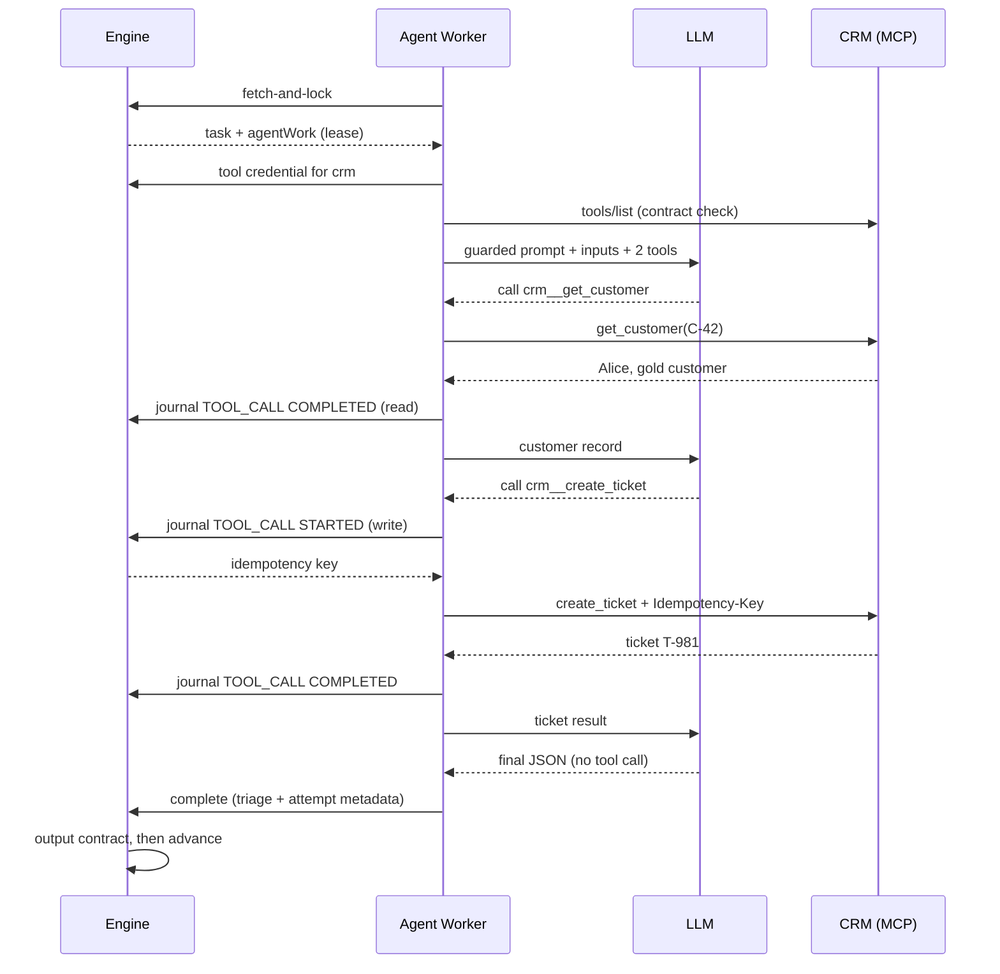

import { Aside } from '@astrojs/starlight/components';

Alice writes to support. The `triage` agent must look her up in the CRM, open
a ticket and hand control back to the process.

## The setup

The project's `crm` tool server:

```yaml
name: crm
transport: streamable-http
url: https://crm-mcp.acme.internal/mcp
credential: crm-token
tools:
  get_customer:  { policy: read }
  create_ticket: { policy: write, idempotency: key }
```

The agent node:

```yaml
- id: triage
  type: agent
  model: gemini-3.6-flash
  prompt: Read the message from ${customerId}, look the customer up, open a ticket and answer in JSON.
  inputs:
    customerId: ${customerId}     # "C-42"
    message: ${message}           # "My parcel never arrived"
  tools: [crm/get_customer, crm/create_ticket]
  result_variable: triage
  output_schema: { type: object, required: [ticketId, priority] }
  confidence_threshold: 80
  next: notify_customer
```

At deployment the engine checks that both tools exist on `crm` and freezes the
URL, policies and credential name with this definition version.

## The sequence



For readability the diagram omits the model-call journaling: every model call
is also journaled `STARTED` before it runs (when the engine checks the limits)
and `COMPLETED` after, with its token counts.

## Step by step

### 1. The worker takes the task

The worker asks for work and the engine hands it the task with a lease. While
the lease is live, nobody else can take it. Abridged:

```json
{
  "id": "task-7f3",
  "topicName": "abada:agent",
  "variables": { "customerId": "C-42", "message": "My parcel never arrived" },
  "agentWork": {
    "profileVersion": "abada.agent/v1",
    "model": "gemini-3.6-flash",
    "toolBindings": [
      { "server": "crm", "tool": "get_customer", "policy": "read", "url": "https://crm-mcp.acme.internal/mcp", "credential": "crm-token" },
      { "server": "crm", "tool": "create_ticket", "policy": "write", "idempotency": "key" }
    ]
  },
  "attempt": 1,
  "steps": []
}
```

The worker then asks for the CRM's secret
(`GET /v1/external-tasks/task-7f3/tool-credentials/crm?workerId=…`). The engine
issues it only to the worker holding the live lease.

### 2. The CRM's contract is checked

The worker opens an MCP session and lists the server's tools. If
`create_ticket` disappeared, or its input schema no longer matches a pinned
`input_schema_sha256`, the attempt stops with `TOOL_CONTRACT_MISMATCH` instead
of guessing.

### 3. The model reasons, the worker acts

The model receives the guarded system message, the declared inputs as
`<input name="…">` blocks, and two functions: `crm__get_customer` and
`crm__create_ticket`. It executes nothing; it only asks for a call.

`get_customer` is a **read**: the worker calls it directly, journals the result
and gives it to the model.

### 4. The write is journaled before it happens

`create_ticket` is a **write**, so the worker must tell the engine first:

```json
POST /v1/external-tasks/task-7f3/steps
{
  "workerId": "agent-worker-1", "attempt": 1, "sequence": 4,
  "kind": "TOOL_CALL", "state": "STARTED", "toolRef": "crm/create_ticket",
  "request": { "callId": "call_2", "arguments": { "customerId": "C-42", "subject": "Parcel not received", "priority": "high" } }
}
```

The engine checks the lease, the attempt, the sequence, the binding and the
limits, stores the step encrypted, and answers with an `idempotencyKey` derived
from the task, attempt and sequence. The worker sends the call with that key as
the `Idempotency-Key` header and in `_meta.idempotencyKey`, then journals
`COMPLETED` with the result.

### 5. The final answer and the output contract

The model answers without a tool call:

```json
{ "ticketId": "T-981", "priority": "high", "summary": "Order 5531 lost, gold customer", "_confidence": 92 }
```

The worker calls `complete` with `triage` and the attempt metadata (model,
provider, tokens, tools, duration, `promptHash`, confidence). In one PostgreSQL
transaction the engine checks that only `triage` is written, that it matches
`output_schema` and that 92 reaches the threshold of 80 — then stores the
variable, moves the token to `notify_customer` and writes history. Otherwise it
takes `on_invalid_output` or `on_low_confidence`. **The model never advances
the process.**

## What a crash in the middle of the write changes

Suppose the worker dies right after sending `create_ticket`, before reading
the answer.

| What happens | Result |
| --- | --- |
| The lease expires and another worker takes the task | it receives the journal: steps 1–3 finished, step 4 `STARTED` |
| Finished steps are replayed from the journal | no model turn is paid for twice |
| `create_ticket` is re-sent with the **same** key | the CRM recognises the key and returns T-981 without a duplicate |
| Had the tool been `idempotency: none` | the engine never re-sends it: the step becomes `OUTCOME_UNKNOWN` and a `TOOL_OUTCOME_UNKNOWN` incident asks a person |

<Aside type="caution" title="At-least-once">
  The CRM call is at-least-once. It takes effect exactly once only when the CRM
  honours the idempotency key; the engine guarantees that it never re-sends a
  write blindly.
</Aside>

Next: [many instances at once](/walkthroughs/concurrency/).
